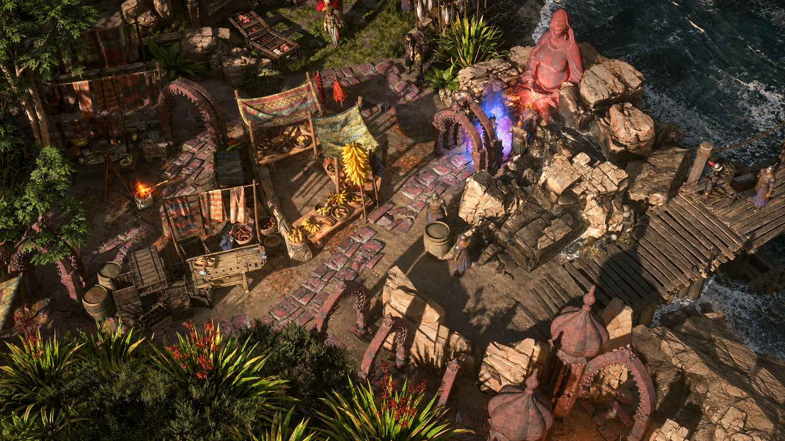

# ScreenStitch

Combine overlapping game screenshots into a panorama while preserving source detail.

The current experiment compares flat and spherical alignment with UI/player masks.
See [results and comparison](output/geometry/REVIEW.md) and
[experiment instructions](experiments/README.md). Three-image tests preserve
source colours but still have seams, duplicated figures and holes. The larger
image-generation attempts were rejected for lost detail and changed colours.

[Local alignment trials](output/geometry/LOCAL_REVIEW.md) retain original pixels
and protect one NPC from seam cuts, but still show distortion and misalignment.
No tested method has produced an accepted full-hideout reconstruction.

The first accepted example combines two Path of Exile 2 hideout screenshots. The model removes the HUD and moving player, joins shared landmarks, and fills small gaps. It can change scene details; the result is not a pixel-exact reconstruction.

## Repeat the method

The historical image-generation method is recorded in [docs/WORKFLOW.md](docs/WORKFLOW.md).

- [Current full-hideout source screenshots](poe2/)
- [Full-hideout test and review](output/imagegen/poe2-full-test.md)
- [Successful prompt and review](output/imagegen/poe2-hideout-v1.md)
- [Exact run arguments and checksums](output/imagegen/poe2-hideout-v1.json)

## Repository layout

- `poe2/`: current 16-image full-hideout source set; preserve these files. The earlier two-image source set is available in Git history at `82b38a6`.
- `output/imagegen/`: saved results and their reproduction records.
- `docs/`: workflow and recent changes.
- `AGENTS.md`: instructions for future agents; `CLAUDE.md` links to it.

The former OpenCV pipeline, tests, sample screenshots and roadmap were removed after the successful image-model experiment. They remain available in Git history at commit `82b38a6`.
